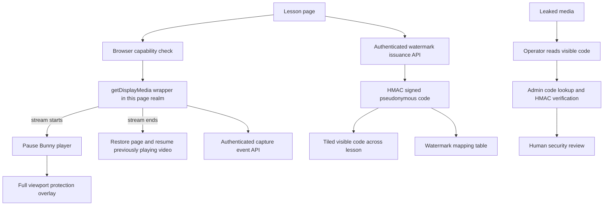
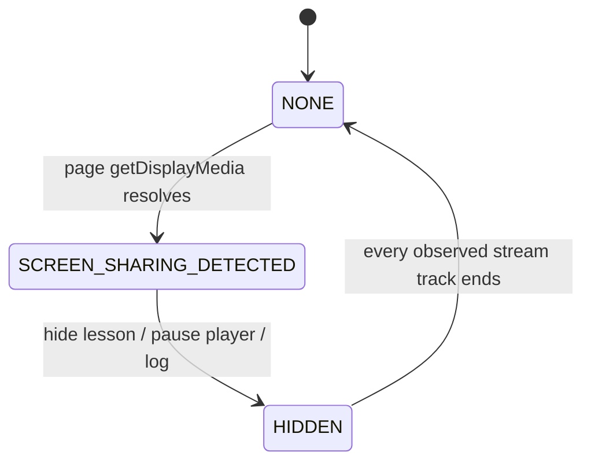

# Capture protection and forensic watermarking

## What this repository implements

This repository is a React/Vite web application. It has no Android Activity, iOS target, native bridge, or media pipeline. The implementation here protects lesson pages when the browser exposes a capture signal, adds a session-specific visible pseudonymous watermark, records confirmed browser events, and lets an authorized teacher resolve a code that has already been read from leaked media.

It does not provide OS-level web screenshot prevention, OS screenshot detection, native Android/iOS protection, OCR, or robust invisible signal extraction from image/video files. The visible watermark is a practical deterrent and lookup marker; its survival through arbitrary crop, re-recording, compression, and edits has not been measured.

## Capability matrix

| Platform | Screenshot prevention | Screenshot detection | Recording prevention | Recording detection | Mirroring detection |
| --- | --- | --- | --- | --- | --- |
| Web app in this repository | Not supported by ordinary page JavaScript | Not supported | Not supported | Partial: observes `getDisplayMedia()` invoked through this page's JavaScript realm | Not supported |
| Android native app (not present) | `FLAG_SECURE` prevents screenshots and non-secure display output for the protected window; behavior can vary by OEM and capture path | Android 14+ screenshot callback detects supported user button screenshots; callback is not invoked for a `FLAG_SECURE` window | `FLAG_SECURE` blocks supported system capture paths; do not treat it as universal | Android 15+ recording visibility callback, with `DETECT_SCREEN_RECORDING`, reports whether this app is visible in a recording | No general public callback specifically for all mirroring/casting states established here |
| iOS native app (not present) | No general public screenshot-prevention API for arbitrary app UI | Screenshot notification is posted after the screenshot | No general UI recording prevention API; FairPlay-protected video has separate capture behavior | Scene capture state reports recording/mirroring/remote control as one state | Included in scene capture state; not distinguished from recording |

`getDisplayMedia()` is an API a page can call to ask the browser to share a display. This code wraps that page API and monitors the returned stream's track end. It does not let a page discover OS screenshot hotkeys, browser chrome capture, extensions, other JavaScript realms, system recorders, or external cameras. See [MDN Screen Capture API](https://developer.mozilla.org/en-US/docs/Web/API/Screen_Capture_API/Using_Screen_Capture).

Android details are based on the official [FLAG_SECURE reference](https://developer.android.com/reference/android/view/WindowManager.LayoutParams#FLAG_SECURE), [Android 14 screenshot detection guide](https://developer.android.com/about/versions/14/features/screenshot-detection), [Activity.ScreenCaptureCallback reference](https://developer.android.com/reference/android/app/Activity.ScreenCaptureCallback), and [WindowManager recording callback reference](https://developer.android.com/reference/android/view/WindowManager#addScreenRecordingCallback(java.util.concurrent.Executor,java.util.function.Consumer)). Android 14 screenshot detection does not return screenshot pixels and its callback is not called for a secure window. Android 15 recording visibility requires `DETECT_SCREEN_RECORDING` and reports whether this app is visible in a recording; it is not a general MediaProjection monitor.

iOS guidance uses Apple's current [scene capture protection guidance](https://developer.apple.com/documentation/swiftui/protecting-sensitive-content-when-screen-sharing), [scene capture state](https://developer.apple.com/documentation/uikit/uiscenecapturestate), and [screenshot notification](https://developer.apple.com/documentation/uikit/uiapplication/userdidtakescreenshotnotification). The screenshot notification arrives after capture, so it is detection, not prevention. The older `UIScreen.isCaptured` API is deprecated in favor of scene capture state.

## Architecture and responsibilities



- `src/lib/captureProtection.ts` declares web capability values, wraps page-realm display capture, tracks stream termination, and supports balanced/strict handling of tab visibility.
- `LessonPage` installs the monitor, requests one signed watermark code for the lesson view, logs event and response pairs, and shows the full-screen overlay while capture is detected.
- `SecureVideo` uses Bunny's player bridge to pause on capture and resumes only if it had been playing before a detected stream ended.
- PDF and DOCX content are covered by the same viewport watermark and response overlay. Hiding the entire lesson viewport also covers images and embeds rendered by lesson blocks.
- `supabase/functions/api/index.ts` creates pseudonymous codes, signs them with `FORENSIC_WATERMARK_SECRET`, stores the resolution mapping, writes capture events, and offers admin-only code resolution.
- `forensic_watermarks` and `capture_events` have RLS enabled and no anon/authenticated access. The Edge Function service role is the only data path.

## Capture state and response



The web response is balanced: only a screen-sharing stream observed through this page triggers hiding. Tab switches, app switching, window blur, and visibility changes do not trigger protection because they are ordinary user actions and do not prove capture is occurring.

The lesson page also observes a best-effort subset of screenshot shortcut key events (`PrintScreen`, Windows `Meta+Shift+S`, and macOS `Meta+Shift+3/4/5`). When a matching key event reaches the page, it logs `SCREENSHOT_SHORTCUT_OBSERVED` and temporarily covers lesson content for 1.8 seconds. This does not block the OS shortcut or prove that the OS completed a screenshot. Many OS-level shortcuts are consumed before a page receives any keyboard event, and the cover cannot guarantee prevention of a capture.

## Watermark and privacy

The Edge Function creates a random pseudonymous ID and an HMAC-SHA-256 integrity tag over the ID, student database ID, lesson ID, hashed session token, and issue timestamp. The visible short code contains the pseudonymous ID plus a truncated integrity tag. The master key remains in Supabase Function secrets. The teacher lookup requires the admin cookie, accepts exact codes or ordered fragments (`?` for one unreadable character, `*` for an unknown-length gap), resolves only a unique match, recomputes the HMAC, and returns the associated learner's display name and database ID for authorized human review. At least eight readable hexadecimal characters are required. It never returns an email, access code, raw session token, or device fingerprint. A valid watermark identifies the learner session to which the code was issued; it does not prove who physically made or distributed a capture.

The visible code is rendered as a subtle repeated page overlay and moves on the video player. This is not an invisible robust watermark, and no claim is made that it survives arbitrary cropping or transcoding. The UI's confidence describes code/signature verification, not a machine-vision extractor's certainty: the operator must first read the code from the media.

Demo-mode codes are prefixed `DEMO-W-` and are not stored or attributable. A production watermark must be issued after the database migration and `FORENSIC_WATERMARK_SECRET` are configured.

## Incident workflow

1. Preserve the original leaked file and document how it was obtained.
2. Have an authorized reviewer read any visible `W-…` code. This build does not parse PNG/JPG/WEBP/PDF/MP4/MOV/WEBM files.
3. In `/admin`, open **Forensic watermark lookup**, enter the full code or any visible fragment in order. Use `?` for one unreadable character and `*` for an unknown-length gap; the fragment can come from either code group. Verify signature integrity and the associated learner/session mapping. If multiple codes match, reveal more characters and retry. If there is no matching record, check demo mode, deployment/project mismatch, migration setup, and transcription.
4. Correlate the returned lesson, hashed session reference, and issue timestamp with authorized records.
5. Record the review and uncertainty. Do not automatically accuse, ban, or penalize a learner based on a code lookup alone.
6. If no code is readable, record the finding as inconclusive. A failed lookup does not prove who did or did not create the leak.

## Deployment

Apply the migration and add a dedicated random 32-byte-or-longer secret:

```sh
supabase db push
supabase secrets set FORENSIC_WATERMARK_SECRET=<random-secret>
supabase functions deploy api --no-verify-jwt
```

The video player watermark no longer includes student name or access code. Existing short-lived Bunny playback URLs remain unchanged. Capture event logging is best effort: page protection still runs if the logging endpoint is unavailable.

## Native implementation requirements before shipping mobile apps

This web repository does not implement native protection. A future Android client must put all protected surfaces in an Activity window with `FLAG_SECURE`, add the Android 14 screenshot callback only where it is useful (it is not called for secure windows), and use the Android 15 recording callback with its documented permission. A future iOS client should observe the current scene capture state, replace protected content with a placeholder, pause media, and separately listen for the post-capture screenshot notification. Neither native platform can detect an external camera reliably.

## Verification and known gaps

- Build-time TypeScript validation verifies the web integration only; it does not establish behavior across browsers or devices.
- Validate capture start/end manually in supported browsers using a real `getDisplayMedia()` caller in the page realm. OS-level screenshot shortcuts should not trigger this monitor.
- No native Android/iOS projects or native capture tests exist in this repository.
- No automated media transformation/survival tests exist yet. The current code watermark is visible text, not a robust spatial/temporal forensic signal.
- No OCR or media upload/extraction pipeline exists. The admin tool performs authenticated code resolution and HMAC verification only.
- Physical camera recording and capture paths hidden from the browser remain impossible to guarantee against.
